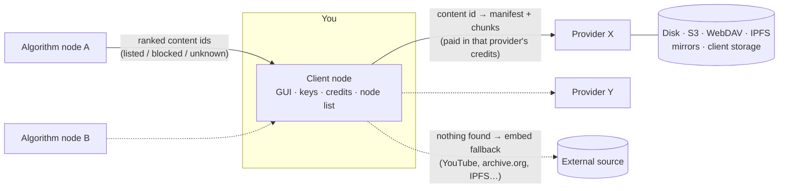

# VibeShare

A decentralized network for sharing and streaming files — video, music, podcasts, images, articles, games, anything. There is no central server: anyone can run any of the three node types, and every user chooses which nodes they trust, in which order.

| Node | What it does |
|---|---|
| **Client** | The app people use: a GUI to watch, listen, read, search, subscribe and publish. It keeps the user's keys, credits, settings and their list of nodes. |
| **Content provider** | Stores content and streams it to clients chunk by chunk, for credits it issues itself. It keeps data on its own disk and/or S3-compatible buckets, WebDAV, IPFS, mirrors, other providers — and on client nodes it pays to store data. |
| **Search algorithm** | Decides what clients see. It lists (whitelist) or blocks (blacklist) content ids, describes them (format, age rating, topics, tags, creator), ranks them however its operator likes and answers searches. Ids it never set are reported as *unknown*. |



Every node is one copy-pastable reference such as

```
vs:provider:vk1veihoj2vhdza5zfo64taqgwrg2j72c3saahgtbmzbbx4km75dlya@https://cdn.example.org
```

Paste it into the client to use the node; delete it or drag it down when it is slow, offline, too expensive or you just don't like it.

## Download and run

VibeShare runs on **macOS, Linux and Windows**. Releases are built by GitHub Actions when a `v*` tag is pushed (see [`.github/workflows/release.yml`](.github/workflows/release.yml)).

| | macOS | Linux | Windows |
|---|---|---|---|
| **Desktop app** (client) | `VibeShare-…-mac-arm64.dmg` / `-x64.dmg` | `.AppImage`, `.deb`, `.tar.gz` | `VibeShare-…-win-x64.exe` installer or `.zip` |
| **Command line** (every node type, GUI included) | `vibeshare-…-macos-arm64` / `-x64` | `vibeshare-…-linux-x64` / `-arm64` | `vibeshare-…-windows-x64.exe` |
| **Docker** (provider, algorithm) | `ghcr.io/mabzgamesstudio/vibeshare` | same | same |

Install the command-line build in one line:

```bash
# macOS and Linux
curl -fsSL https://raw.githubusercontent.com/MabzGamesStudio/VibeShare/main/scripts/install.sh | sh
```

```powershell
# Windows (PowerShell)
irm https://raw.githubusercontent.com/MabzGamesStudio/VibeShare/main/scripts/install.ps1 | iex
```

The binaries are not code-signed yet: on macOS the installer clears the quarantine flag (or right-click → Open once); on Windows choose *More info → Run anyway* in SmartScreen.

Then:

```bash
vibeshare demo --open        # a provider, an algorithm node and a client with sample content
vibeshare client --open      # just the client: the app in your browser
vibeshare provider --public-url https://cdn.example.org
vibeshare algorithm --public-url https://feed.example.org
vibeshare --help
```

### From source (Node.js 22+)

```bash
npm install && npm --prefix gui install
npm run build                # compiles the nodes (dist/) and the GUI (gui/dist/)
node dist/cli.js demo --open
```

Desktop app from source: `npm run build && cd desktop && npm install && npm start` (`npm run dist` builds installers for the current OS).

## Try the demo

`vibeshare demo --open` starts a whole network on your machine (client on :7700, provider on :7701, algorithm node on :7702) with generated sample content: music streamed in 1 MiB chunks, artwork, articles, an open movie that only exists on YouTube/the Internet Archive, a native content id whose providers are gone (so the client falls back to the copy named in the id), and a blocked scam post. It prints the operators' admin tokens and two voucher codes to try topping up credits. Data lives in your app-data folder under `demo`; pass `--data <dir>` to put it elsewhere.

## The client


- **Home** asks your algorithm nodes for content matching your preferences (formats, highest age rating, favourite topics, creator kinds, hidden tags and creators, languages). With several algorithm nodes the feed blends them by priority, or uses only the first that answers.
- **Explore** searches with filters. Queries understand `#tag`, `@creator`, `format:music` and `topic:science`. Pasting a content id or a link opens it directly.
- **Subscriptions** shows the newest content of the creators you follow, from every algorithm node.
- **Watch** streams native content from your providers (seeking only fetches the chunks it needs; every chunk is checked against its hash). When no provider has it, the content is embedded from the external source carried in its id. Blocked content and content no algorithm node has reviewed are gated according to your settings. Like/dislike and *Suggest* (tags, topics, format, age rating or a report — with a reason and the timestamp that shows it) earn credits on algorithm nodes that reward them.
- **Publish** uploads a file to the providers you pick and submits it to algorithm nodes for review. Files are signed with your key so people can subscribe to you as a creator. You can also list content that lives elsewhere (YouTube, Vimeo, SoundCloud, Spotify, TikTok, X, Twitch, archive.org, PeerTube, IPFS or any link).
- **Nodes** is where you add nodes by pasting references (one per line, or plain URLs), reorder them (drag or arrows), switch them on and off, set a price limit, pick the account mode, and share your whole list with someone else.
- **Credits** shows your balance on each node — credits never move between nodes — with each node's payment methods (vouchers, crypto, Lightning, card checkout, manual) and history.
- **Earn** turns on the storage service (offer disk space to providers for credits) and shows your contributions to algorithm nodes.
- **Settings**: preferences, account mode for new nodes, creator profile, cache size, IPFS gateway, theme, and your identity backup.

### Accounts on nodes

Each node keeps its own credits, so the client opens an account on every node it uses. Per node you choose:

| Mode | What the node sees | If you reinstall |
|---|---|---|
| **Private key for this node** (default) | A key derived from your backup for that node only; nodes cannot link you across nodes | Restore your backup and every account comes back |
| **My public identity** | Your main public key, the same everywhere | Restore your backup |
| **Anonymous token** | A random token, nothing else | Credits are lost with the device |

Your identity backup (*Settings → Identity*) is a single `vibeshare-seed-…` string.

## Running a content provider

```bash
vibeshare provider --data /var/lib/vibeshare/provider --public-url https://cdn.example.org
```

It prints its reference, the dashboard address (`/admin`) and the admin token. Everything is in `<data>/config.json` and editable from the dashboard:

- **Pricing** — credits per MiB and per manifest, a free daily allowance, per-content prices, upload pricing (open, paid or closed), and a share of download credits paid to uploaders.
- **Credits for new accounts**, optional **proof of work** and per-IP limits against account farming, anonymous accounts on or off.
- **Payment methods** — vouchers, ETH and ERC-20 tokens on any EVM chain, on-chain bitcoin, SOL and SPL tokens, Lightning (LNbits), hosted checkouts with signed webhooks (Stripe, or anything that can sign a webhook) and manual approval.
- **Storage backends** — local disk, S3-compatible (AWS, Cloudflare R2, Backblaze B2, Wasabi, MinIO, Storj, Filebase…), WebDAV (Nextcloud, rclone…), IPFS, read-only HTTP mirrors, other VibeShare providers (pull-through mirroring) and client nodes, with priorities and replication.
- **Storage service** — jobs that pay client nodes to keep copies: you choose the content, the number of copies, how long, and the rewards (upfront, per retrieval, per passed proof-of-storage challenge, at completion).

See [docs/OPERATORS.md](docs/OPERATORS.md) and [examples/provider.config.json](examples/provider.config.json).

## Running a search algorithm node

```bash
vibeshare algorithm --data /var/lib/vibeshare/algorithm --public-url https://feed.example.org
```

From its dashboard the operator reviews submissions, lists or blocks content ids, edits metadata and creators, accepts suggestions (or lets them be accepted once N accounts agree), imports a provider's catalog for review, sets prices for feeds/searches/lookups, sets rewards for votes and accepted suggestions, chooses a ranking strategy (`balanced`, `hot`, `new`, `top`, `random`) or plugs in **its own ranking module** ([example](examples/ranking/ranker.mjs)), and caps the age rating it serves.

## How it works

- **Content ids.** Native content is split into chunks (1 MiB by default). A JSON manifest lists the chunks' hashes; the content id is `vs1` + the base32 SHA-256 of the manifest. Nothing has to be trusted: clients check every manifest and chunk against its hash. Manifests can be signed by the creator's key.
- **Sources in the id.** An id can carry fallbacks: `vs1…~yt:dQw4w9WgXcQ~ia:some-item`. Ids of external content are just the source: `yt:…`, `vimeo:…`, `ia:…`, `ipfs:…`, `url:…`. If no provider has native content, the client embeds the first fallback.
- **Node references** pin the node's Ed25519 key, and `/v1/info` is signed by it, so a hijacked domain cannot impersonate a node.
- **Credits** are per node and never leave it. Clients pay providers per chunk and algorithm nodes per request (if they charge); nodes pay clients for services.
- **Storage service.** Client nodes keep a long-poll open to the providers they store for, so providers can request chunks or proofs of storage (a hash of a fresh nonce and the chunk) even behind NAT. Providers use these copies when their own backends miss a chunk.

The full wire protocol is in [docs/PROTOCOL.md](docs/PROTOCOL.md).

## Repository layout

```
src/shared/     protocol types, content ids, manifests, crypto, node references, HTTP, storage
src/commerce/   per-node ledger, accounts (anonymous / key + proof of work), payment methods, base node
src/provider/   content provider node: store, storage backends, storage service, routes
src/algorithm/  search algorithm node: registry, ranking, search, contributions, routes
src/client/     client daemon: node manager, fetcher/streaming, publisher, storage worker, local API
src/demo/       demo network with generated sample media
src/cli.ts      the `vibeshare` command
gui/            React GUI (client app at /, node dashboard at /admin)
desktop/        Electron desktop app for the client
scripts/        standalone binary builds, installers, icon
examples/       operator configs, custom ranking module, systemd units
tests/          unit, integration and end-to-end tests
```

## Development

| Command | What it does |
|---|---|
| `npm test` | Unit, integration and end-to-end tests (`tests/`) |
| `npm run typecheck` | TypeScript checks for the nodes, tests and GUI |
| `npm run demo` | The demo network from source (`tsx`) |
| `npm run client` / `provider` / `algorithm` | One node from source |
| `npm --prefix gui run dev` | Vite dev server on :5173, proxying `/api` and `/stream` to a client on :7700 (open it with `?t=<token>`; the token is in the client page's `vs-token` meta tag) |
| `npm run build` | Compiles to `dist/` and `gui/dist/` |
| `npm run binaries` | Standalone executables for every OS in `release/` (needs [Bun](https://bun.sh)) |
| `docker compose up -d` | A provider and an algorithm node in containers |

## Status and limits

This is a first version. Things to know:

- **Live streaming** is not implemented yet; streaming is on-demand (chunked, seekable).
- Provider and algorithm nodes need a reachable address (a public IP, a reverse proxy or a tunnel). Client nodes do not, even when they store data for providers.
- Crypto payments are verified against the operator's own RPC/explorer endpoints; invoices are identified by a unique amount, so pay the exact amount shown.
- The JSON-file storage of nodes suits small and medium nodes; very large catalogs would want a database.
- Desktop apps and binaries are unsigned until signing certificates are configured in the release workflow.

## License

Apache License 2.0 — see [LICENSE](LICENSE).
