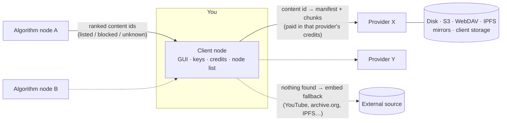
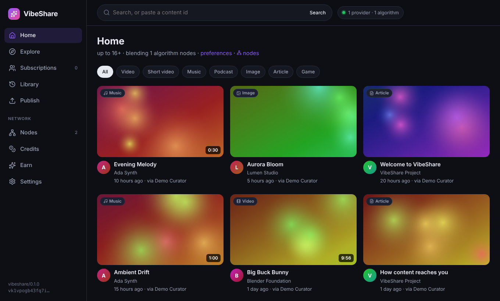

# VibeShare

A decentralized network for sharing and streaming files — video, music, podcasts, images, articles, games, anything. There is no central server: anyone can run any of the three node types, and every user chooses which nodes they trust, in which order.

| Node | What it does |
|---|---|
| **Client** | The app people use: a GUI to watch, listen, read, search, subscribe and publish — as a desktop app, from the command line, or as a static website. It keeps the user's keys, credits, settings and their list of nodes. |
| **Content provider** | Stores content and streams it to clients chunk by chunk, for credits it issues itself. It keeps data on its own disk and/or S3-compatible buckets, WebDAV, IPFS, mirrors, other providers — and on client nodes it pays to store data. |
| **Search algorithm** | Decides what clients see. It lists (whitelist) or blocks (blacklist) content ids, describes them (format, age rating, topics, tags, creator), ranks them however its operator likes and answers searches. Ids it never set are reported as *unknown*. |



Every node is one copy-pastable reference such as

```
vs:provider:vk1veihoj2vhdza5zfo64taqgwrg2j72c3saahgtbmzbbx4km75dlya@https://cdn.example.org
```

Paste it into the client to use the node; delete it or drag it down when it is slow, offline, too expensive or you just don't like it.

## Download and run

VibeShare runs on **macOS, Linux, Windows and iOS**. Releases are built by GitHub Actions when a `v*` tag is pushed (see [`.github/workflows/release.yml`](.github/workflows/release.yml)).

| | macOS | Linux | Windows |
|---|---|---|---|
| **Desktop app** (client) | `VibeShare-…-mac-arm64.dmg` / `-x64.dmg` | `.AppImage`, `.deb`, `.tar.gz` | `VibeShare-…-win-x64.exe` installer or `.zip` |
| **Command line** (every node type, GUI included) | `vibeshare-…-macos-arm64` / `-x64` | `vibeshare-…-linux-x64` / `-arm64` | `vibeshare-…-windows-x64.exe` |
| **Docker** (provider, algorithm) | `ghcr.io/mabzgamesstudio/vibeshare` | same | same |
| **iPhone and iPad** | `VibeShare-unsigned.ipa` from the *iOS app* workflow (install with AltStore or Sideloadly), or TestFlight — see [mobile/README.md](mobile/README.md) | | |
| **Web client** (no install) | [mabzgamesstudio.github.io/WebPages/pages/vibeShare/web](https://mabzgamesstudio.github.io/WebPages/pages/vibeShare/web/) — any browser | same | same |

Install the command-line build in one line:

```bash
# macOS and Linux
curl -fsSL https://raw.githubusercontent.com/MabzGamesStudio/VibeShare/main/scripts/install.sh | sh
```

```powershell
# Windows (PowerShell)
irm https://raw.githubusercontent.com/MabzGamesStudio/VibeShare/main/scripts/install.ps1 | iex
```

The binaries are not code-signed yet: on macOS the installer clears the quarantine flag (or right-click → Open once); on Windows choose *More info → Run anyway* in SmartScreen.

Then:

```bash
vibeshare demo --open        # a provider, an algorithm node and a client with sample content
vibeshare client --open      # just the client: the app in your browser
vibeshare provider --public-url https://cdn.example.org
vibeshare algorithm --public-url https://feed.example.org
vibeshare --help
```

### From source (Node.js 22+)

```bash
npm install && npm --prefix gui install
npm run build                # compiles the nodes (dist/) and the GUI (gui/dist/)
node dist/cli.js demo --open
```

Desktop app from source: `npm run build && cd desktop && npm install && npm start` (`npm run dist` builds installers for the current OS).

## Try the demo

`vibeshare demo --open` starts a whole network on your machine (client on :7700, provider on :7701, algorithm node on :7702) with generated sample content: vertical shorts for the Shorts page, a video, artwork of every shape for the Images page, music streamed in 1 MiB chunks, articles, an open movie that only exists on YouTube/the Internet Archive, a native content id whose providers are gone (so the client falls back to the copy named in the id), and a blocked scam post. When the machine is online, the algorithm node's crawler adds content from other platforms as well. It prints the operators' admin tokens and two voucher codes to try topping up credits. Data lives in your app-data folder under `demo`; pass `--data <dir>` to put it elsewhere.

## The client



- **Credits in the top bar.** The top right shows your credits on your first provider and your first algorithm node (hover for every node; *+N* counts the others), live: they change the moment a node's answer changes them — while a video streams, when a vote earns a credit — and briefly show by how much. A dot shows whether the node answered your last request.
- **Pages.** The left panel lists your pages. Three come preset — **Videos**, **Shorts** and **Images** — and *New page* adds your own. Each page picks its content (recommendations from your algorithm nodes, a saved search, or the newest from your subscriptions; formats, topics, creator kinds, a lower age rating), its layout and what it shows with each item, in your order. *Customize* on any page (or *Settings → Pages*) edits it with a live preview; pages can be reordered, hidden from the panel, duplicated, reset or deleted.
  - **Videos**: a grid of large thumbnails with title, creator and platform (VibeShare for content published here) — swap the platform for the like count, add views or duration, drop the thumbnail…
  - **Shorts**: one vertical video at a time, filling the screen. Swipe (or scroll, or use ↑/↓) to the next or previous one; the short in view plays and the others stop. Tap to pause, one tap for sound, like, share or open the details.
  - **Images**: an endless one-column feed of images (videos in it play as they scroll into view).
  - Layouts: grid, list, vertical swipe, one-column feed, masonry wall. Thumbnails show only the picture and a video's length — no age rating or media badges. Every list loads more as you scroll, after a short pause (*Settings → Pause before loading more*, 1.5 s by default) so fast scrolling doesn't spend credits faster than you can look.
- **Explore** searches with filters. Queries understand `#tag`, `@creator`, `format:music` and `topic:science`. Pasting a content id or a link opens it directly. Algorithm nodes also look your query up on other platforms, so creators and titles from elsewhere show up too. Every search — and every explore page, query or not — starts with a few pieces published on VibeShare when they match (or simply are published, on an explore page), even ones you have seen before.
- **Subscriptions** shows the newest content of the creators you follow, from every algorithm node, with the subscriptions themselves as a carousel along the top. Its first button opens **all subscriptions**: every creator on one page, searchable, with unsubscribe and a way to add new subscriptions (search for creators, or paste a creator id).
- **Watch** shows content in its own shape — a vertical short in a tall frame, a square image in a square one, a wide video across the page — as large as the window allows. It streams native content from your providers (seeking only fetches the chunks it needs; every chunk is checked against its hash). When no provider has it, the content plays from the platform it came from — its media file, or the platform's player. Blocked content and content no algorithm node has reviewed are gated according to your settings. Like/dislike and *Suggest* earn credits on nodes that reward them: the suggest modal has one tab for **content provider nodes** (missing source links — platform + link, one id can carry several — a duplicate content id, or uploading the content data when no node has it) and one for **algorithm search nodes** (all of that plus corrections to the tags, topics, format, age rating, creator or publish time, each with a reason and the timestamp that shows it). *Report stats* posts the numbers the platform shows — views, likes, comments, subscribers, upvotes, the post date — and nodes pay for what is new to them, more for popular and recent content. When content data is missing entirely, the suggest modal uploads it from a picked file or pulls it from a URL: the content id is the hash of the data, so the client calculates it on this device and fills the field in before anything is uploaded.
- **Dual** splits the screen in half and shows two different tabs at once — two vertical video scrolls side by side by default, each half switchable to any of your pages. The choice of each half is remembered.
- **Share** on any item, the watch page or a short opens a popup: copy the link, send it to another app, or show a **QR code** (download as PNG or SVG). Links open the [web client](#the-web-client) on that content — `https://mabzgamesstudio.github.io/WebPages/pages/vibeShare/web/#/watch/<id>` by default; *Settings → Sharing* points them at another hosted copy.
- **Publish** uploads a file to the providers you pick and submits it to algorithm nodes for review. Files are signed with your key so people can subscribe to you as a creator. You can also list content that lives elsewhere (YouTube, Vimeo, Dailymotion, SoundCloud, Spotify, TikTok, Instagram, X, Bluesky, Mastodon, Twitch, archive.org, PeerTube, IPFS or any link).
- **Nodes** is where you add nodes by pasting references (one per line, or plain URLs), reorder them (drag or arrows), switch them on and off, set a price limit, pick the account mode, and share your whole list with someone else.
- **No background requests.** The client never polls your nodes: it learns whether a node is up, and your balance there, from the answers to the requests you make anyway, and passes changes to the GUI as they happen.
- **Languages.** *Settings → Content preferences → Languages* (English by default) keeps titles that could be in the languages you pick. It only looks at the letters a title uses, and leniently: a title in Cyrillic, Arabic or Japanese script is not English, and many letters missing from a language's alphabet rule it out, but an English title with *café* in it still passes. Content whose language is known is matched by that instead. Nodes filter by it, and the client again for nodes that do not.
- **Tor.** *Settings → Tor* sends requests to nodes through Tor (the Tor service, or Tor Browser while it is open): only to nodes at `.onion` addresses (the default), or to every node — then through a node's own onion address when it has one, and in the desktop app the window's own traffic too. *Test Tor* checks that traffic leaves through Tor. In a browser, open the web client in Tor Browser instead.
- **Credits** shows your balance on each node — credits never move between nodes — with each node's payment methods (vouchers, crypto, Lightning, card checkout, manual) and history.
- **Earn** turns on the storage service (offer disk space to providers for credits) and shows your contributions to algorithm nodes.
- **Settings**: pages, preferences, languages, account mode for new nodes, Tor, creator profile, cache size, IPFS gateway, theme, the share address, and your identity backup. **Profiles** keep several users (or personas) of one client apart — each with its own nodes, settings, history and client id, public, locked with a username and a password, or **hidden**: then it does not appear anywhere, not even that it exists, and its data is stored encrypted with its password.

### Accounts on nodes

Each node keeps its own credits, so the client opens an account on every node it uses. Per node you choose:

| Mode | What the node sees | If you reinstall |
|---|---|---|
| **Private key for this node** (default) | A key derived from your backup for that node only; nodes cannot link you across nodes | Restore your backup and every account comes back |
| **My public identity** | Your main public key, the same everywhere | Restore your backup |
| **Anonymous token** | A random token, nothing else | Credits are lost with the device |

Your identity backup (*Settings → Identity*) is a single `vibeshare-seed-…` string.

## The web client

[`distribution/`](distribution) builds the client into a static website (hash routes, so any static host works) that shared links open. It is the whole client — pages, shorts, search, publishing, credits — with its backend running in the browser: a service worker keeps the visitor's keys and nodes in the browser, calls the nodes directly, checks every chunk and streams with seeking. `distribution/config.json` names the nodes a first-time visitor starts with and where shared links point; `npm run build:web` writes the site to `distribution/web/`, ready to copy into a GitHub Pages repository (or let the *Web client* workflow publish it). Nodes it talks to need HTTPS. Details: [distribution/README.md](distribution/README.md).

The **iOS app** ([`mobile/`](mobile)) is this web client in a native shell (Capacitor). The *iOS app* workflow builds it on macOS: an unsigned `.ipa` for sideloading, a simulator build, and — with App Store Connect secrets — signed builds for TestFlight. Details: [mobile/README.md](mobile/README.md).

## Running a content provider

```bash
vibeshare provider --data /var/lib/vibeshare/provider --public-url https://cdn.example.org
```

It prints its reference, the dashboard address (`/admin`) and the admin token. Everything is in `<data>/config.json` and editable from the dashboard:

- **Pricing** — credits per MiB and per manifest, a free daily allowance, per-content prices, upload pricing (open, paid or closed), and a share of download credits paid to uploaders.
- **Content** — the hosted files; clicking one opens everything the node knows about it (manifest metadata, sources, chunks and the backends holding them, downloads and credits), and the missing data clients suggested — source links, duplicate content ids, absent data — to accept or reject.
- **Credits for new accounts**, optional **proof of work** and per-IP limits against account farming, anonymous accounts on or off.
- **Payment methods** — vouchers, ETH and ERC-20 tokens on any EVM chain, on-chain bitcoin, SOL and SPL tokens, Lightning (LNbits), hosted checkouts with signed webhooks (Stripe, or anything that can sign a webhook) and manual approval.
- **Storage backends** — local disk, S3-compatible (AWS, Cloudflare R2, Backblaze B2, Wasabi, MinIO, Storj, Filebase…), WebDAV (Nextcloud, rclone…), IPFS, read-only HTTP mirrors, other VibeShare providers (pull-through mirroring) and client nodes, with priorities and replication.
- **Storage service** — jobs that pay client nodes to keep copies: you choose the content, the number of copies, how long, and the rewards (upfront, per retrieval, per passed proof-of-storage challenge, at completion).
- **Peering** — other content providers, with what flows each way: this node fetches the chunks it is missing from them (each chunk is addressed by the hash of its bytes) and serves or pushes chunks to them, content by content or automatically on reads.

Provider and algorithm nodes can also be **Tor onion services**: with Tor running (and its `ControlPort` on), `--onion` — or *Settings → Publish as a Tor onion service* — publishes the node at a `.onion` address that stays the same across restarts. Clients with Tor reach it without the node having a public address or open port; with a public URL too, clients that send everything through Tor use the onion address. `tor.outbound` sends the node's own requests to other nodes (and the crawler) through Tor as well ([docs/OPERATORS.md](docs/OPERATORS.md#tor)).

See [docs/OPERATORS.md](docs/OPERATORS.md) and [examples/provider.config.json](examples/provider.config.json).

## Running a search algorithm node

```bash
vibeshare algorithm --data /var/lib/vibeshare/algorithm --public-url https://feed.example.org
```

From its dashboard the operator reviews submissions, lists or blocks content ids (seeing each entry's preview image, kept on the node), edits metadata and creators, accepts suggestions (or lets them be accepted once N accounts agree), imports a provider's catalog for review, sets prices for feeds/searches/lookups, sets rewards for votes and accepted suggestions, configures the claim credit multipliers of every content source (one weight per metric — views, likes, comments, subscribers, upvotes… — and a recency factor that decays to 1×), lists other nodes as peers to exchange content metadata with (asking one for the metadata of a cid or a link, or for new cids and links by criteria — platform, ids vs links, content numbers, filters — with the peer answering from its newest, most popular or a random mix), chooses a ranking strategy (`balanced`, `hot`, `new`, `top`, `random`) or plugs in **its own ranking module** ([example](examples/ranking/ranker.mjs)), and caps the age rating it serves.

**Discovery.** A crawler keeps finding content on other platforms in the background: YouTube channels, PeerTube instances and SepiaSearch, Dailymotion, the Internet Archive, Wikimedia Commons, Openverse, Flickr, Mastodon hashtags, Bluesky and Lemmy, plus any websites the operator seeds (pages' OpenGraph/JSON-LD media and links to platforms, identified through oEmbed). It follows every site's `robots.txt` (for each URL and redirect, with Crawl-delay), spaces its requests to each host and never fetches private addresses. Each find gets a format from the platform and the media's shape — portrait video is a short — an age rating from the platform's flags and topics from its words. Client searches are also sent to the platforms (with a short wait, cached), and the queries become new discovery topics. Finds are listed right away or wait in *Review* as pending; the operator's own decisions are never overridden. The *Crawler* tab turns adapters on and off, runs them, adds seed sites and shows what each host's robots.txt blocked ([docs/OPERATORS.md](docs/OPERATORS.md#discovery-crawler)).

**Platform APIs.** Many platforms only allow automated access through their official API. In the *API keys* tab the operator pastes credentials from their own developer accounts for Vimeo, Twitch, YouTube, Flickr, Unsplash, Pexels, GIPHY, Tenor, Imgur, DeviantArt, Europeana, Reddit, Tumblr, X, Instagram, Spotify, Jamendo and Freesound. Each API gets a daily budget: crawling may use part of it, the rest is kept for client searches, which also query the API while there is budget left. A platform that answers "too many requests" is paused until it says so.

**Sources.** The *Sources* tab lists every source of content — VibeShare itself and each platform — with how much of it is listed. Untick a source to stop crawling it (what it found before is hidden too) and give each a priority from 0 (hidden) to 10: feeds and search results favour higher priorities, and content published on VibeShare starts at 10. Lists of sites to only crawl, or never crawl, narrow the web crawler further ([docs/OPERATORS.md](docs/OPERATORS.md#platform-apis)).

## How it works

- **Content ids.** Native content is split into chunks (1 MiB by default). A JSON manifest lists the chunks' hashes; the content id is `vs1` + the base32 SHA-256 of the manifest. Nothing has to be trusted: clients check every manifest and chunk against its hash. Manifests can be signed by the creator's key.
- **Sources in the id.** An id can carry fallbacks: `vs1…~yt:dQw4w9WgXcQ~ia:some-item`. Ids of external content are just the source: `yt:…`, `vimeo:…`, `ia:…`, `ipfs:…`, `url:…`. If no provider has native content, the client embeds the first fallback.
- **Node references** pin the node's Ed25519 key, and `/v1/info` is signed by it, so a hijacked domain cannot impersonate a node.
- **Credits** are per node and never leave it. Clients pay providers per chunk and algorithm nodes per request (if they charge); nodes pay clients for services.
- **Storage service.** Client nodes keep a long-poll open to the providers they store for, so providers can request chunks or proofs of storage (a hash of a fresh nonce and the chunk) even behind NAT. Providers use these copies when their own backends miss a chunk.

The full wire protocol is in [docs/PROTOCOL.md](docs/PROTOCOL.md).

## Repository layout

```
src/shared/     protocol types, content ids, manifests, crypto, node references, HTTP, storage
src/commerce/   per-node ledger, accounts (anonymous / key + proof of work), payment methods, base node
src/provider/   content provider node: store, storage backends, storage service, routes
src/algorithm/  search algorithm node: registry, ranking, search, contributions, routes
src/client/     client core (node manager, verified streaming, publisher, local API) and the daemon around it
src/demo/       demo network with generated sample media
src/cli.ts      the `vibeshare` command
gui/            React GUI (client app at /, node dashboard at /admin); gui/src/web: the web client's backend
distribution/   the static web client: config.json and the built site (web/)
desktop/        Electron desktop app for the client
mobile/         iOS app (Capacitor around the web client)
scripts/        standalone binary builds, installers, icon
examples/       operator configs, custom ranking module, systemd units
tests/          unit, integration and end-to-end tests
```

## Development

| Command | What it does |
|---|---|
| `npm test` | Unit, integration and end-to-end tests (`tests/`) |
| `npm run typecheck` | TypeScript checks for the nodes, tests and GUI |
| `npm run demo` | The demo network from source (`tsx`) |
| `npm run client` / `provider` / `algorithm` | One node from source |
| `npm --prefix gui run dev` | Vite dev server on :5173, proxying `/api` and `/stream` to a client on :7700 (open it with `?t=<token>`; the token is in the client page's `vs-token` meta tag) |
| `npm run build` | Compiles to `dist/` and `gui/dist/` |
| `npm run build:web` | Builds the static web client into `distribution/web/` |
| `npm run binaries` | Standalone executables for every OS in `release/` (needs [Bun](https://bun.sh)) |
| `docker compose up -d` | A provider and an algorithm node in containers |

## Status and limits

This is a first version. Things to know:

- **Live streaming** is not implemented yet; streaming is on-demand (chunked, seekable).
- Provider and algorithm nodes need a reachable address (a public IP, a reverse proxy or a tunnel) — or a Tor onion address (`--onion`), which needs neither. Client nodes do not, even when they store data for providers.
- Crypto payments are verified against the operator's own RPC/explorer endpoints; invoices are identified by a unique amount, so pay the exact amount shown.
- The JSON-file storage of nodes suits small and medium nodes; very large catalogs would want a database.
- Desktop apps and binaries are unsigned until signing certificates are configured in the release workflow.
- The crawler's platform adapters follow each platform's public API or feed format; they are tested against recorded responses, and platforms change their APIs from time to time. YouTube search needs a Data API key (channel feeds do not); the platforms in the *API keys* tab do nothing until the operator adds credentials, and each platform's developer terms (attribution, caching, rate limits, approval for some APIs such as Instagram's hashtag search or X's paid tiers) are the operator's to follow.
- The web client cannot run the storage service (it only runs while a page is open).
- The iOS app plays native content once its file is downloaded (no streaming without service workers), and does not run the storage service.

## License

Apache License 2.0 — see [LICENSE](LICENSE).
