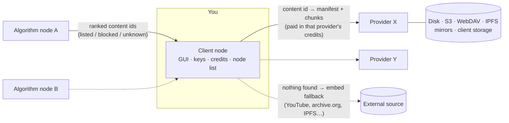

# VibeShare

A decentralized network for sharing and streaming files — video, music, podcasts, images, articles, games, anything. There is no central server: anyone can run any of the three node types, and every user chooses which nodes they trust, in which order.

| Node | What it does |
|---|---|
| **Client** | The app people use: a GUI to watch, listen, read, search, subscribe and publish — as a desktop app, from the command line, or as a static website. It keeps the user's keys, credits, settings and their list of nodes. |
| **Content provider** | Stores content and streams it to clients chunk by chunk, for credits it issues itself. It keeps data on its own disk and/or S3-compatible buckets, WebDAV, IPFS, mirrors, other providers — and on client nodes it pays to store data. |
| **Search algorithm** | Decides what clients see. It lists (whitelist) or blocks (blacklist) content ids, describes them (format, age rating, topics, tags, creator), ranks them however its operator likes and answers searches. Ids it never set are reported as *unknown*. |



Every node is one copy-pastable reference such as

```
vs:provider:vk1veihoj2vhdza5zfo64taqgwrg2j72c3saahgtbmzbbx4km75dlya@https://cdn.example.org
```

Paste it into the client to use the node; delete it or drag it down when it is slow, offline, too expensive or you just don't like it.

## Install and run

VibeShare runs on **macOS, Linux, Windows and iOS**, plus a no-install web client. Download the desktop app or command-line build, or install in one line:

```bash
# macOS and Linux
curl -fsSL https://raw.githubusercontent.com/MabzGamesStudio/VibeShare/main/scripts/install.sh | sh
```

```powershell
# Windows (PowerShell)
irm https://raw.githubusercontent.com/MabzGamesStudio/VibeShare/main/scripts/install.ps1 | iex
```

```bash
vibeshare demo --open        # a provider, an algorithm node and a client with sample content
vibeshare client --open      # just the client: the app in your browser
vibeshare provider --public-url https://cdn.example.org
vibeshare algorithm --public-url https://feed.example.org
```

All downloads (per-OS packages, Docker, 32-bit Linux servers, iOS, the web client), first-run detail and building from source: **[docs/QUICKSTART.md](docs/QUICKSTART.md)**.

## What's inside

- **[docs/CLIENT.md](docs/CLIENT.md)** — the client app: pages (Videos, Shorts, Images and your own), watching and sharing, publishing, earning credits, settings, profiles, privacy features, the web client and iOS build.
- **[docs/NODES.md](docs/NODES.md)** — running provider and algorithm nodes: the admin console, storage backends, tiers, the storage service, peering, payments, crawling.
- **[docs/OPERATORS.md](docs/OPERATORS.md)** — every configuration key, Tor, and the security checklist.
- **[docs/PROTOCOL.md](docs/PROTOCOL.md)** — the wire protocol: identifiers, node info, accounts, credits, and every route as tables.
- **[docs/ARCHITECTURE.md](docs/ARCHITECTURE.md)** — the codebase: module map, import graph, where each kind of change goes.
- **[docs/EXTENDING.md](docs/EXTENDING.md)** — ranking modules, storage backends, payment methods, crawler adapters, hosting platforms, with worked examples.
- **[docs/INDEX.md](docs/INDEX.md)** — the map of all documentation.

## How it works

- **Content ids.** Native content is split into chunks (1 MiB by default). A JSON manifest lists the chunks' hashes; the content id is `vs1` + the base32 SHA-256 of the manifest. Nothing has to be trusted: clients check every manifest and chunk against its hash. Manifests can be signed by the creator's key.
- **Sources in the id.** An id can carry fallbacks: `vs1…~yt:dQw4w9WgXcQ~ia:some-item`. Ids of external content are just the source: `yt:…`, `vimeo:…`, `ia:…`, `ipfs:…`, `url:…`. If no provider has native content, the client embeds the first fallback.
- **Node references** pin the node's Ed25519 key, and `/v1/info` is signed by it, so a hijacked domain cannot impersonate a node.
- **Credits** are per node and never leave it. Clients pay providers per chunk and algorithm nodes per request (if they charge); nodes pay clients for services.
- **Storage service.** Client nodes keep a long-poll open to the providers they store for, so providers can request chunks back even behind NAT.

## Repository layout

`src/shared/` (wire types and commons) · `src/node/` (the server-node base: identity, ledger, accounts, payments, moderation — recently renamed from `src/commerce/`) · `src/provider/` · `src/algorithm/` · `src/client/` · `src/demo/` · `src/cli.ts` · `gui/` (React app + admin console) · `distribution/` (static web client) · `desktop/` · `mobile/` · `scripts/` · `examples/` · `tests/`. Full map: [docs/ARCHITECTURE.md](docs/ARCHITECTURE.md).

## Development

`npm test` and `npm run typecheck` cover the nodes, tests and GUI; `npm run demo` runs the demo from source; `npm run build` compiles to `dist/` and `gui/dist/`. The full command table and the guide for navigating the code are in [docs/ARCHITECTURE.md](docs/ARCHITECTURE.md).

## Status and limits

This is a first version. Things to know:

- **Live streaming** is not implemented yet; streaming is on-demand (chunked, seekable).
- Provider and algorithm nodes need a reachable address (a public IP, a reverse proxy or a tunnel) — or a Tor onion address (`--onion`), which needs neither. Client nodes do not, even when they store data for providers.
- Crypto payments are verified against the operator's own RPC/explorer endpoints; invoices are identified by a unique amount, so pay the exact amount shown. Monero and Lightning-address payments (and anything else a node cannot check itself) are confirmed by the operator in their wallet, and every payment comes with a receipt signed by the node and kept locally by the client.
- **Crypto safety**: VibeShare only ever needs **public addresses** — never enter a seed phrase or a private key anywhere in it, and nodes refuse to store one. This software is vibe-coded and may have vulnerabilities, and it is an open source free market: pay only small amounts you can afford to lose and keep anything substantial in a wallet you control.
- The JSON-file storage of nodes suits small and medium nodes; very large catalogs would want a database.
- Desktop apps and binaries are unsigned until signing certificates are configured in the release workflow.
- The crawler's platform adapters follow each platform's public API or feed format; platforms change their APIs from time to time and each platform's developer terms are the operator's to follow.
- The web client cannot run the storage service (it only runs while a page is open); the iOS app plays native content once its file is downloaded.

## License

Apache License 2.0 — see [LICENSE](LICENSE).
