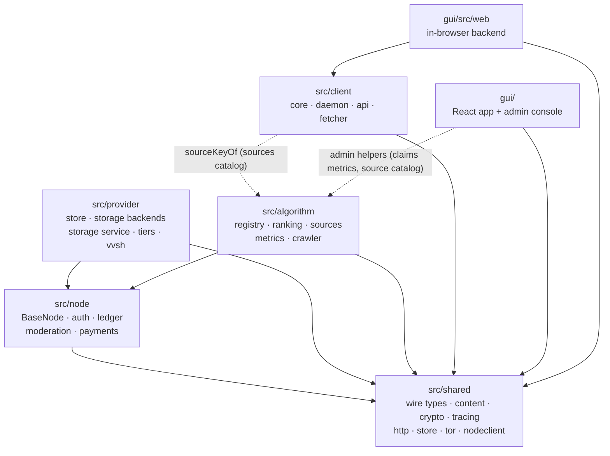

# VibeShare architecture

How the code fits together: the three node types, what they share, where the
browser/Node boundary runs, and where each kind of extension goes. For the wire
contract see [PROTOCOL.md](PROTOCOL.md); for operating nodes see
[OPERATORS.md](OPERATORS.md); every document is listed in [INDEX.md](INDEX.md).

> **`src/commerce` was just renamed to `src/node`.** Older branches, comments or
> conversations may still say `src/commerce`; on this tree the base-node code lives
> in [`src/node/`](../src/node). The big modules are split by domain
> (`protocol/`, `payments/`, `hosting/`, the `client/` collaborators,
> `algorithm/routes/`) — this document names the folders and the contracts inside
> them, which is what stays true.

## The three node types and what they share

| Node type | Code | Runs | Role |
|---|---|---|---|
| **Client node** | [`src/client/`](../src/client) + the GUI at [`gui/`](../gui) | Desktop app, `vibeshare client`, or the static web client | Holds the user's keys, credits, node list and settings; verifies every manifest and chunk; streams, publishes, votes. Serves its GUI and a local API on `127.0.0.1:7700`. |
| **Content provider** | [`src/provider/`](../src/provider) | `vibeshare provider`, Docker, systemd | Stores content (own disk, S3, WebDAV, IPFS, mirrors, other providers, client nodes) and streams it chunk by chunk for its own credits. Runs the storage service and content tiers. |
| **Search algorithm node** | [`src/algorithm/`](../src/algorithm) | `vibeshare algorithm`, Docker, systemd | Decides what clients see: lists or blocks content ids, owns metadata, ranks, answers feeds/searches/lookups, runs the discovery crawler, hosts comments and groups/topics. |

The two server node types build on one shared base, `BaseNode` in
[`src/node/node.ts`](../src/node/node.ts): Ed25519 identity and signed `/v1/info`,
admin-token auth, the ledger and accounts (anonymous / key + proof of work),
payment methods, moderation, the local trace log, the HTTP server and Tor
routing. The client node is its own daemon (`src/client/daemon.ts`) because it
must also run in a browser — see the boundary below.

## Directory map (`src/`)

| Directory | What lives there |
|---|---|
| [`src/shared/`](../src/shared) | **The wire and the commons.** Protocol types (`protocol.ts`, a barrel re-exporting `protocol/` by domain), content ids/manifests, crypto, node references, canonical JSON encoding, HTTP server + router (Node), JSON file store (Node), Tor (Node), the node client (`nodeclient.ts`), the browser-safe `remote.ts` fetch layer, tracing (`tracing.ts` everywhere, `tracing-node.ts` on Node), VVSH/WebM codecs, client settings defaults, taxonomy/sources/comments/language helpers. |
| [`src/node/`](../src/node) | **The server-node base** (formerly `src/commerce/`): `node.ts` (BaseNode: identity, routes, config, admin API), `auth.ts` (sessions, proof of work), `ledger.ts` (credits), `moderation.ts` (bans, rate limits, peer sync), `payments/` (one module per payment method behind the `PaymentMethod` contract in `payments/interface.ts`; `payments/index.ts` holds the `Payments` class and the registry). |
| [`src/provider/`](../src/provider) | **Provider node**: `node.ts` (routes + the `ProviderNode` class), `store.ts` (content index + chunk reads), `storage/` (blob backends: local, S3, WebDAV, IPFS, HTTP mirrors, other providers), `service.ts` (the storage service: jobs, assignments, retrieval tasks), `tiers.ts` (content tiers), `transcode.ts` / `ffmpeg.ts` / `vvsh.ts` (VVSH conversion). |
| [`src/algorithm/`](../src/algorithm) | **Algorithm node**: `node.ts` (the `AlgorithmNode` coordinator: config, lifecycle, delegates) and `routes/` (one module per domain, each `registerXRoutes(node)`), `support.ts` (paging/matching helpers), `contributions.ts` (contribution types + validators), `registry.ts` (catalog: entries, creators, thumbnails), `ranking.ts` (built-in strategies + custom modules), `sources.ts` (content-source catalog and priorities — imported by the client and GUI too), `metrics.ts` (claim credit multipliers), `crawler/` (`crawler.ts`, `fetcher.ts` (polite fetcher), `robots.ts`, `html.ts`, `oembed.ts`, `types.ts` (the `Adapter` contract), `adapters/` (one module per platform family: `video`, `images`, `social`, `apis`, `web`)). |
| [`src/client/`](../src/client) | **Client core + daemon**: `daemon.ts` (HTTP server, local API wiring, uploads, streams, the storage-service worker, Tor), `api.ts` (the complete local `/api` route table), `core.ts` (coordinator) plus its collaborators `feeds.ts`, `content.ts`, `credits.ts`, `publish.ts`, `profile.ts`, `nodes.ts` (node list + `NodeClient` sessions), `fetcher.ts` (verified manifest/chunk downloads), `publisher.ts`, `service.ts` (storage jobs this client holds), `bloom.ts` (seen-content filters), `trace.ts` (the trace-log shape the browser-safe modules use). |
| [`src/demo/`](../src/demo) | The demo network: a provider, an algorithm node and a client with generated sample content (`vibeshare demo`). |
| [`src/cli.ts`](../src/cli.ts) | The `vibeshare` command: `client`, `provider`, `algorithm`, `demo`, `info`. |

Around `src/`: `gui/` is the React GUI (the client app at `/`, the node admin
console at `/admin`, shared widgets in `gui/src/components`; `gui/src/web/` is the
web client's in-browser backend). `tests/` mirrors the modules, `examples/`
holds operator configs, a custom ranking module and systemd units,
`distribution/` is the static web client, `desktop/` the Electron app and
`mobile/` the iOS shell.

## Import graph

Everything depends on `src/shared`; the server node types additionally stand on
`src/node`. Two small standing exceptions, both importing the *browser-safe*
source catalog that happens to live under `src/algorithm`: the client core and
the GUI use `sourceKeyOf` / `SOURCE_CATALOG`. `gui/src/web` runs the real client
core in the browser (see the boundary below).

## The wire-vs-Node boundary

`src/shared` is split in two on disk. **Browser-safe** modules live directly in
`src/shared/`; they have no Node imports and are bundled into the GUI, the web
client and the service worker. **Node-only** modules live in
[`src/shared/node/`](../src/shared/node), import `node:*` builtins and only run in
a daemon or node process. The boundary is enforced by
[`tests/shared/wire-boundary.test.ts`](../tests/shared/wire-boundary.test.ts):
it fails if a wire module imports a Node builtin or reaches into
`src/shared/node/`.

**Browser-safe (wire):** `protocol.ts` + `protocol/` (the wire types),
`clientapi.ts`, `clientdefaults.ts`, `sources.ts`, `noderef.ts`, `comments.ts`,
`comment-view.ts`, `taxonomy.ts`, `encoding.ts`, `content.ts` (ids/manifests),
`bloom.ts`, `vvsh.ts`, `vvsh-encode.ts`, `vvsh-transcode.ts`, `webm.ts`,
`tracing.ts`, `version.ts`, `language.ts`, `errors.ts`,
`profiles.ts`, `builtin-content.ts`, `gui-embedded.ts`, `remote.ts` (the fetch
wrapper — despite living beside the Node HTTP code, it is browser-safe by design).

**Node-only (`src/shared/node/`):** `http.ts` (the HTTP server and router, plus the
route manifest), `routes.ts` (the shared route-table shape), `store.ts` (JSON file
store), `contentfile.ts`, `assets.ts` (embedded GUI bundle), `tor.ts` (Tor router +
onion service), `tracecontext.ts` (AsyncLocalStorage), `tracing-node.ts` (the
persisted `TraceStore` and its routes), `log.ts` and `devbuild.ts` (process-aware).

**`crypto.ts` is the one with a twin.** `src/shared/crypto.ts` uses
`node:crypto`; the web build swaps in [`gui/src/web/crypto.ts`](../gui/src/web/crypto.ts)
(a WebCrypto/@noble implementation with the same exports) via the alias plugin in
[`gui/vite.web.config.ts`](../gui/vite.web.config.ts). The tests assert the two
implementations agree. Anything else that imports `nodecrypto` stays out of the
browser; `nodeclient.ts` is the node-side HTTP client (sessions, signed info) —
the GUI only takes *types* from it.

**Rule of thumb when editing:** a module that must work in the web client may
import only browser-safe modules (and `crypto`, knowing the swap exists). A
module that touches the filesystem, sockets or `node:*` belongs on the Node side
and is tested through the daemon or node tests.

## Where to add things

| To add | Where | Full walkthrough |
|---|---|---|
| A server route | The node's `registerRoutes()` (public) or `adminRoutes()` in `src/node/node.ts`, `src/provider/node.ts`, `src/algorithm/node.ts`; wire types in `src/shared/protocol/` | [EXTENDING.md — routes](EXTENDING.md#routes) |
| A client local-API route | `on('METHOD', '/api/…')` in [`src/client/api.ts`](../src/client/api.ts) (daemon-only pieces in `src/client/daemon.ts`) | [EXTENDING.md — routes](EXTENDING.md#routes) |
| A payment method | One module in [`src/node/payments/`](../src/node/payments) implementing `PaymentMethod` (`interface.ts`), registered in `index.ts` | [EXTENDING.md — payment methods](EXTENDING.md#payment-methods) |
| A storage backend | A `BlobBackend` in [`src/provider/storage/backends.ts`](../src/provider/storage/backends.ts) + its config in the `BackendConfig` union + the switch in `ProviderNode.createBackend` | [EXTENDING.md — storage backends](EXTENDING.md#storage-backends) |
| A crawler platform adapter | An `Adapter` in [`src/algorithm/crawler/adapters/`](../src/algorithm/crawler/adapters) registered in the adapter list | [EXTENDING.md — crawler adapters](EXTENDING.md#crawler-platform-adapters) |
| A hosting platform (client Earn) | A `HostingPlatform` module in `gui/src/earn/hosting/platforms/` registered in `HOSTING_PLATFORMS` (`platforms/index.ts`) | [EXTENDING.md — hosting platforms](EXTENDING.md#hosting-platforms) |
| A ranking strategy | Config only for the built-ins; a custom ES module for anything else (`ranking.module`) | [EXTENDING.md — ranking](EXTENDING.md#custom-ranking-modules) |

## Node-type responsibility matrix

| | Client | Provider | Algorithm |
|---|---|---|---|
| Holds user keys, credits per node, node list | ✓ | — | — |
| Stores content bytes | optional (paid storage jobs) | ✓ | thumbnails only |
| Serves manifests + chunks for credits | — | ✓ | — |
| Serves `.vvsh` verifiable streams | plays them | ✓ (stores + converts) | — |
| Lists / blocks content ids | — | — | ✓ |
| Content metadata, creators, groups, topics | shows them | creator-declared metadata | ✓ (owns it) |
| Ranking and feeds / search | — | — | ✓ |
| Discovery crawler + platform APIs | — | — | ✓ |
| Comments | reads/writes | — | ✓ (stores, moderates) |
| Storage service (pays clients to hold data) | holds data, earns | ✓ (runs jobs) | — |
| Content tiers (paid lifecycle) | buys tiers | ✓ | — |
| Payments (sells credits) | buys | ✓ | ✓ |
| Moderation (bans, rate limits) | — | ✓ | ✓ |
| Peering with same-kind nodes | — | ✓ (chunks) | ✓ (metadata) |
| Local trace log + tracing view | ✓ | ✓ | ✓ |

## How to navigate for an AI assistant

- **Read the wire first.** `src/shared/protocol.ts` (re-exporting
  `src/shared/protocol/`) is the contract; [PROTOCOL.md](PROTOCOL.md) is its
  human-readable tables. When code and prose disagree, the code wins and the doc
  should be fixed.
- **Entry points:** `src/cli.ts` → `src/client/daemon.ts` / `src/provider/node.ts`
  / `src/algorithm/node.ts`. Each server node: `src/node/node.ts` (`BaseNode`)
  plus the type's `registerRoutes()`. The client's whole local API is one table in
  `src/client/api.ts`.
- **Verify paths on disk before citing them.** Splits land often (`src/node/`,
  `src/shared/protocol/`, `src/node/payments/`, per-module client and algorithm
  files); prefer naming the contract (`BlobBackend`, `PaymentMethod`, `Adapter`)
  over a file path when the layout may move.
- **The GUI is one app, two faces:** `gui/src/pages/` (client) and
  `gui/src/admin/` (node dashboards), sharing `gui/src/components/`. It talks
  HTTP only — no direct store access — except `gui/src/web/`, which runs the
  client core in the browser.
- **Tracing is off by default** and every trace call is a no-op until enabled;
  keep new instrumentation cheap behind `shouldLog` guards.
- **Style:** TypeScript strict; comments explain *why*, never *what*; error
  messages name what to do. Before handing over: `npm run typecheck` and
  `npm test` from the repo root.
