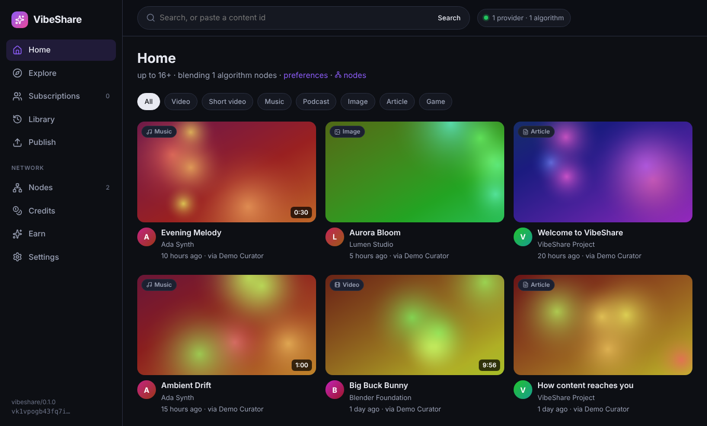
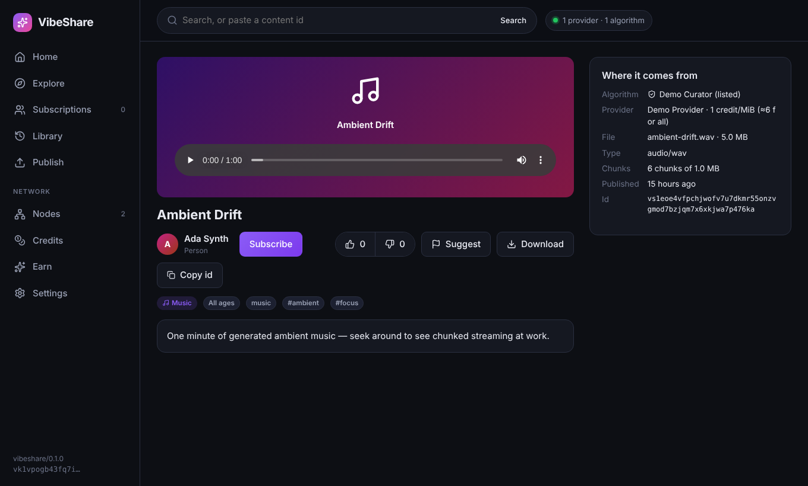
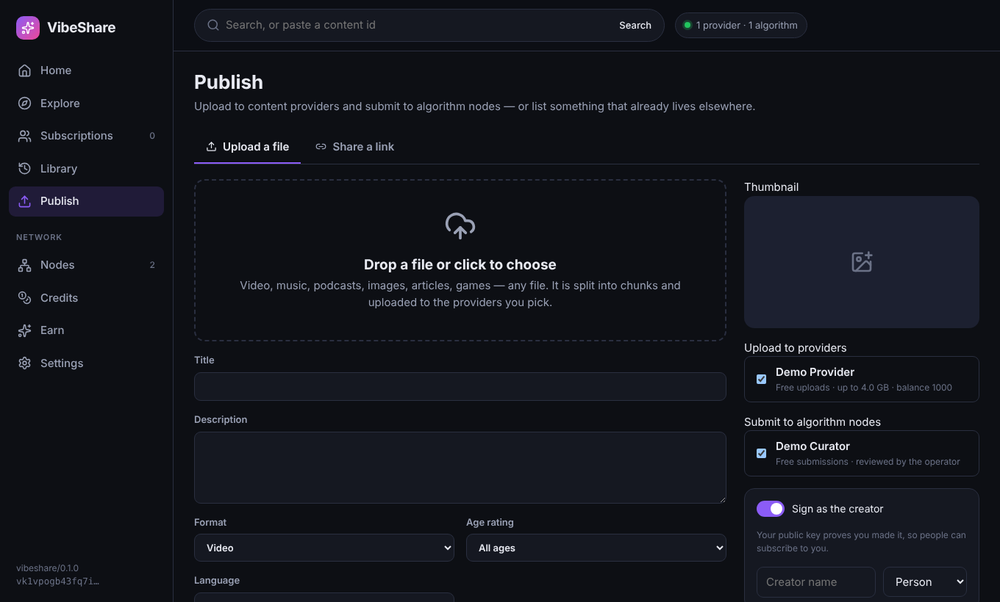
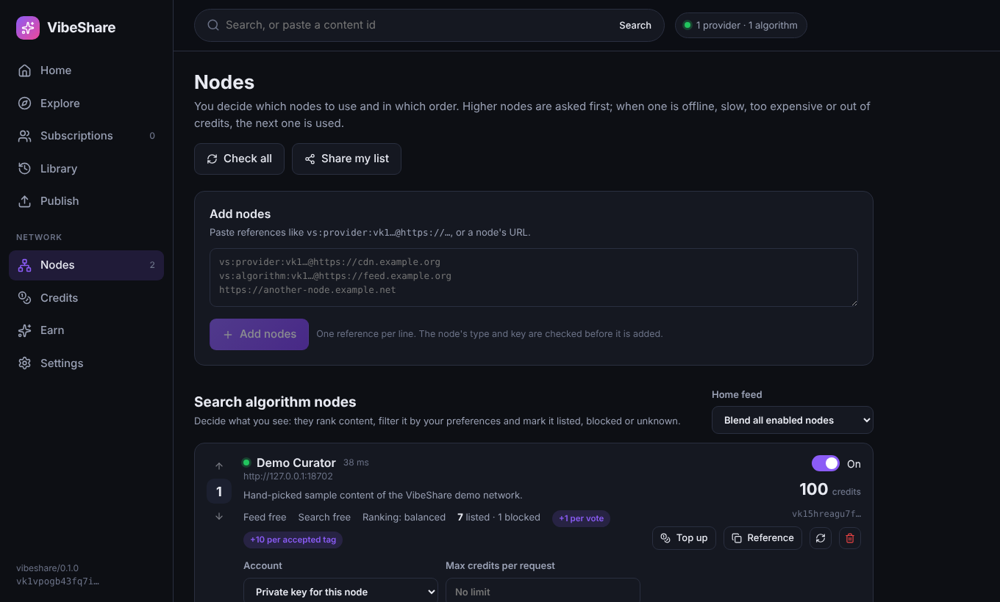

# The client app

The app people use: watch, listen, read, search, subscribe and publish — as a
desktop app, from the command line (`vibeshare client`, the GUI opens in your
browser at `http://127.0.0.1:7700`), or as the static web client. It keeps the
user's keys, credits, settings and their list of nodes; nothing is stored on any
server.

## Credits in the top bar

The top right shows your credits on your first provider and your first algorithm
node (hover for every node; *+N* counts the others), live: they change the moment
a node's answer changes them — while a video streams, when a vote earns a credit —
and briefly show by how much. A dot shows whether the node answered your last
request. Credits are per node and never move between nodes.

## Pages

The left panel lists your pages. Three come preset — **Videos**, **Shorts** and
**Images** — and *New page* adds your own. Each page picks its content
(recommendations from your algorithm nodes, a saved search, or the newest from
your subscriptions; formats, topics, creator kinds, a lower age rating), its
layout and what it shows with each item, in your order. *Customize* on any page
(or *Settings → Pages*) edits it with a live preview; pages can be reordered,
hidden from the panel, duplicated, reset or deleted.

- **Videos**: a grid of large thumbnails with title, creator and platform
  (VibeShare for content published here) — swap the platform for the like count,
  add views or duration, drop the thumbnail…
- **Shorts**: one vertical video at a time, filling the screen. Swipe (or scroll,
  or use ↑/↓) to the next or previous one; the short in view plays and the others
  stop. Tap to pause, one tap for sound, like, share or open the details.
- **Images**: an endless one-column feed of images (videos in it play as they
  scroll into view).
- Layouts: grid, list, vertical swipe, one-column feed, masonry wall. Thumbnails
  show only the picture and a video's length — no age rating or media badges.
  Every list loads more as you scroll, after a short pause
  (*Settings → Pause before loading more*, 1.5 s by default) so fast scrolling
  doesn't spend credits faster than you can look. *Settings → Content preferences
  → Show content previews* controls both preview display and whether preview URLs
  are requested from algorithm nodes.

## Groups and topics

A **group** is a list of content creators: it is searched, subscribed to and
opened exactly like a creator, and its page shows its members in a carousel with
the content of all of them together below. A **topic** is a category of content:
it has its own page (name, description, icon, the newest content filed under it,
and a way to subscribe), you can create one when a search finds none, and the
description of any content links the topics, creators and groups it belongs to.
Both can be subscribed to like a creator, and a page can whitelist or blacklist a
creator, a group or a topic with the *+* buttons in *Customize*.

## Explore, search and subscriptions

**Explore** searches with filters. Queries understand `#tag`, `@creator`,
`format:music` and `topic:science`. Pasting a content id or a link opens it
directly. Algorithm nodes also look your query up on other platforms, so creators
and titles from elsewhere show up too. Every feed/search surface starts with a few
matching VibeShare-published pieces, even ones you have seen before; a page
filtered to particular formats gets up to three native suggestions per format.
The client also keeps native results ahead after blending algorithm nodes.

**Subscriptions** shows native content first and then the newest content of the
creators you follow, from every algorithm node, with the subscriptions themselves
as a carousel along the top. Its first button opens **all subscriptions**: every
creator on one page, searchable, with unsubscribe and a way to add new
subscriptions (search for creators, or paste a creator id).

## Watch

**Watch** shows content in its own shape — a vertical short in a tall frame, a
square image in a square one, a wide video across the page — as large as the
window allows. It streams native content from your providers (seeking only fetches
the chunks it needs; every chunk is checked against its hash). When no provider
has it, the content plays from the platform it came from — its media file, or the
platform's player. Blocked content and content no algorithm node has reviewed are
gated according to your settings.

Like/dislike and *Suggest* earn credits on nodes that reward them: the suggest
modal has one tab for **content provider nodes** (missing source links — platform
+ link, one id can carry several — a duplicate content id, or uploading the
content data when no node has it) and one for **algorithm search nodes** (all of
that plus corrections to the tags, topics, format, age rating, creator or publish
time, each with a reason and the timestamp that shows it). *Report stats* posts
the numbers the platform shows — views, likes, comments, subscribers, upvotes,
the post date — and nodes pay for what is new to them. When content data is
missing entirely, the suggest modal uploads it from a picked file or pulls it
from a URL: the content id is the hash of the data, so the client calculates it
on this device and fills the field in before anything is uploaded.

**Share** on any item, the watch page or a short opens a popup: copy the link,
send it to another app, or show a **QR code** (download as PNG or SVG). Links open
the [web client](#the-web-client-and-ios) on that content —
`https://mabzgamesstudio.github.io/WebPages/pages/vibeShare/web/watch/<id>` by
default; *Settings → Sharing* points them at another hosted copy.

## Publishing

**Publish** uploads a file to the providers you pick and submits it to algorithm
nodes for review. Files are signed with your key so people can subscribe to you as
a creator. You can also list content that lives elsewhere (YouTube, Vimeo,
Dailymotion, SoundCloud, Spotify, TikTok, Instagram, X, Bluesky, Mastodon,
Twitch, archive.org, PeerTube, IPFS or any link).

## Nodes

**Nodes** is where you add nodes by pasting references (one per line, or plain
URLs), reorder them (drag or arrows), switch them on and off, set a price limit,
pick the account mode, and share your whole list with someone else. A node
reference such as
`vs:provider:vk1veihoj2vhdza5zfo64taqgwrg2j72c3saahgtbmzbbx4km75dlya@https://cdn.example.org`
pins the node's key — a hijacked domain cannot impersonate it.

## Accounts on nodes

Each node keeps its own credits, so the client opens an account on every node it
uses. Per node you choose:

| Mode | What the node sees | If you reinstall |
|---|---|---|
| **Private key for this node** (default) | A key derived from your backup for that node only; nodes cannot link you across nodes | Restore your backup and every account comes back |
| **My public identity** | Your main public key, the same everywhere | Restore your backup |
| **Anonymous token** | A random token, nothing else | Credits are lost with the device |

Your identity backup (*Settings → Identity*) is a single `vibeshare-seed-…`
string.

## Earning credits

**Earn** is where the credits come in, in four tabs:

- **Algorithm nodes** — your credits per node and every credit-earning method per
  platform (reporting stats, votes, accepted suggestions).
- **Provider nodes** — credits per node and the URL jobs you host for providers
  (each with a *Give up* button), plus the *URL jobs* card: the data hosting URLs
  connected to this client, one button that finds the provider's jobs and uploads
  every one of them to every URL with its access token. Nothing is kept on this
  machine — the provider gets the full retrieved data from the URLs.
- **Provider jobs** — base URLs on free static hosting (GitHub Pages, Cloudflare
  Pages, GitLab Pages, Netlify, Vercel, Firebase, Render, Appwrite, Surge,
  Neocities, Codeberg Pages, AWS S3, Azure Blob Storage, Google Cloud Storage).
  Every platform is walked through in five panels — *Account & site*, *Access
  details*, *Base URL & content ids*, *Save & offer* and *Review* — as numbered
  steps with the exact clicks, copy buttons and a check at the end of every step.
- **Algorithm jobs** — how to maximize credits for updating content metadata with
  popular and new content on platforms.

## Settings and profiles

**Settings** covers pages, content preferences (formats, topics, age rating,
previews), languages, account mode for new nodes, Tor, creator profile, cache
size, IPFS gateway, theme, the share address, debug logs and tracing
(Settings → Logging), and your identity backup.

**Profiles** keep several users (or personas) of one client apart — each with its
own nodes, settings, history and client id — public, locked with a username and
a password, or **hidden**: then it does not appear anywhere, not even that it
exists, and its data is stored encrypted with its password.

## Privacy and safety

- **No background requests.** The client never polls your nodes: it learns
  whether a node is up, and your balance there, from the answers to the requests
  you make anyway.
- **Per-node pseudonyms** (the default account mode) mean nodes cannot link your
  activity across nodes.
- **Tor.** *Settings → Tor* sends requests to nodes through Tor (the Tor service,
  or Tor Browser while it is open): only to nodes at `.onion` addresses (the
  default), or to every node — then through a node's own onion address when it
  has one, and in the desktop app the window's own traffic too. *Test Tor* checks
  that traffic leaves through Tor. In a browser, open the web client in Tor
  Browser instead.
- **Languages.** *Settings → Content preferences → Languages* (English by
  default) keeps titles that could be in the languages you pick, judged leniently
  by the letters a title uses.
- **Crypto safety.** VibeShare only ever needs **public addresses** — never enter
  a seed phrase or a private key anywhere in it, and nodes refuse to store one.
  This software is vibe-coded and may have vulnerabilities; pay only small amounts
  you can afford to lose and keep anything substantial in a wallet you control.

## The web client and iOS

[`distribution/`](../distribution) builds the client into a static website (hash
routes, so any static host works) that shared links open. It is the whole client —
pages, shorts, search, publishing, credits — with its backend running in the
browser: a service worker keeps the visitor's keys and nodes in the browser,
calls the nodes directly, checks every chunk and streams with seeking.
`distribution/config.json` names the nodes a first-time visitor starts with and
where shared links point; `npm run build:web` writes the site to
`distribution/web/`. Nodes it talks to need HTTPS. Details:
[distribution/README.md](../distribution/README.md).

The **iOS app** ([`mobile/`](../mobile)) is this web client in a native shell
(Capacitor), built by the *iOS app* workflow: an unsigned `.ipa` for sideloading,
a simulator build, and — with App Store Connect secrets — signed TestFlight
builds. Details: [mobile/README.md](../mobile/README.md).

Known limits: live streaming is not implemented (streaming is on-demand,
chunked, seekable); the web client cannot run the storage service (it only runs
while a page is open); the iOS app plays native content once its file is
downloaded and does not run the storage service.
