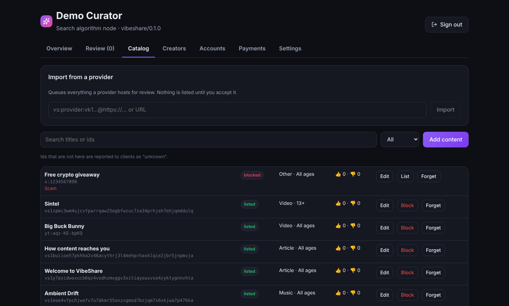

# Running provider and algorithm nodes

Anyone can run a node. Both server types are one command, one data directory and
a web dashboard; this page orients you, [OPERATORS.md](OPERATORS.md) documents
every configuration key, and [PROTOCOL.md](PROTOCOL.md) is the wire contract
clients expect you to speak.

```bash
vibeshare provider  --data /var/lib/vibeshare/provider  --public-url https://cdn.example.org
vibeshare algorithm --data /var/lib/vibeshare/algorithm --public-url https://feed.example.org
```

On first start a node prints its **reference** (what clients paste to add it),
its `/admin` dashboard address and the **admin token**. The data directory
contains `identity.json` (the node's key — **back it up**), `admin-token`,
`config.json` and the node's own data files; the full table is in
[OPERATORS.md](OPERATORS.md). `--config`, `--port`, `--host`, `--public-url` and
`--name` override the config for one run. Install and deployment (Docker,
systemd, reverse proxies, 32-bit Linux): [QUICKSTART.md](QUICKSTART.md).

## The admin console

Every node serves its dashboard at `/admin`, gated by the admin token. The tab
bar (some tabs carry hover menus with further pages):

| Provider node | Search algorithm node |
|---|---|
| Overview (reference, stats, node info) | Overview |
| Content (hover: *Add locally*, *Client suggestion*) | Review (hover: *Submissions*, *Suggestions*, *Content for creators*, *Creator icons*, *Account links*) |
| Storage (backends) | Catalog (hover: *Catalog*, *Creators*, *Groups*, *Topics*) |
| Tiers | Claims (credit multipliers per source) |
| Peers (peering + content sync) | Peers (peering + metadata exchange + content sync) |
| Accounts (hover: *Moderation*) | Crawler · API keys · Sources · Comments |
| Payments (invoices, vouchers) | Accounts (hover: *Moderation*) |
| Tracing (the node's local trace log) | Payments |
| Settings (hover: every settings group) | Tracing · Settings |

*Settings* groups: **General**, **Logging and tracing** (both kinds), then
provider: *Prices and storage*, *Rewards*, *Content URLs*, *Storage service*;
algorithm: *Ranking*, *Prices*, *Rewards*, *Policy and creators*, *Discovery*,
*Peering*, *Seen-content filters*, *Comments*, *Console*. Everything lives in
`<data>/config.json` and can be edited as JSON in *Settings* as well; host and
port changes need a restart.



## Both node types share

- **Accounts and credits.** Each node runs its own ledger: credits for new
  accounts, optional proof of work and per-IP signup limits, anonymous accounts
  on or off, manual credit adjustments and notes per account.
- **Credit transfers** — accounts may send credits to another account when the
  sender holds at least `transfers.minSenderBalance` (default **1000**; 0
  disables the gate). Set per node in *Settings → Credits transfers*.
- **Payments** — selling credits for: vouchers, ETH and ERC-20 tokens on any EVM
  chain, on-chain bitcoin, SOL and SPL tokens, Monero, Lightning (LNbits),
  hosted checkouts with signed webhooks (Stripe, or anything that can sign a
  webhook) and manual approval. Methods only ever hold **public addresses**.
  Details: [OPERATORS.md](OPERATORS.md#payment-methods).
- **Moderation** — bans, temporary bans and rate limits for accounts, IPs and
  peer nodes, synced with peers so one operator's ban reaches the network.
- **Tor onion services** — with Tor running (and its `ControlPort` on),
  `--onion` publishes the node at a `.onion` address that stays the same across
  restarts; clients with Tor reach it without a public address or open port.
  `tor.outbound` sends the node's own requests (and the crawler) through Tor.
- **Tracing** — a local trace log (off by default; nothing is recorded until
  turned on in *Settings → Logging and tracing*) with the *Tracing* tab: search,
  time span, level filters and one timeline per API request. Stored trace events
  are pruned after the configured expiration.
- **Peering** with same-kind nodes (chunks for providers, metadata for algorithm
  nodes) — see below and [OPERATORS.md](OPERATORS.md).

## Content provider

The provider stores content and streams it to clients chunk by chunk, for credits
it issues itself.

- **Pricing** — credits per MiB and per manifest, a free daily allowance,
  per-content prices, upload pricing (open, paid or closed), and a share of
  download credits paid to uploaders. A chunk costs
  `ceil(bytes × perMiB / 1 MiB)` after the account's free allowance.
- **Content** — the hosted files; clicking one opens everything the node knows
  about it (manifest metadata, sources, chunks and the backends holding them,
  downloads and credits). Client suggestions (missing source links, duplicate
  content ids, absent data) are reviewed here.
- **Storage backends** — local disk, S3-compatible (AWS, Cloudflare R2,
  Backblaze B2, Wasabi, MinIO, Storj, Filebase…), WebDAV (Nextcloud, rclone…),
  IPFS, read-only HTTP mirrors, other VibeShare providers (pull-through
  mirroring) and client nodes — with priorities and replication. Config reference:
  [OPERATORS.md](OPERATORS.md#storage-backends).
- **Tiers** — prices for keeping content on the node: each tier is one price for
  a size class and a duration. Any user can see a content's tier and lifecycle
  (`GET /v1/content/:cid/tier`) and spend credits to assign or extend it
  (`POST /v1/content/:cid/tier`); the *Tiers* tab assigns content in batches and
  shows per-tier counts. A tier can drive a managed storage-service job
  automatically.
- **Storage service** — jobs that pay client nodes to keep copies: the content,
  the number of copies, the term and the rewards (`upfront` on acceptance once
  the client's endpoint answers, `perRetrieval` each time this node fetches a
  chunk back, `completion` at the end of the term). Retrieval is on demand plus a
  configurable interval of endpoint tests; a client whose endpoint fails is
  removed from the job and the job reopens for another client.
- **Peering** — other content providers, with what flows each way (`send` /
  `receive` per peer): this node fetches chunks it is missing from them (each
  chunk addressed by the hash of its bytes), serves or pushes chunks to them, and
  pushes whole contents per manifest. The *Peers* tab drives manual and automatic
  sync.
- **Content URLs** — clients register URLs (or base URLs) where they host copies
  of content; this node pulls from them and pays the client per verified download.
  Accept/review is the operator's (`autoAccept` can skip it).
- **Credit transfers** — the shared minimum-sender-balance gate applies here too:
  `transfers.minSenderBalance`, default 1000, set in *Settings → Credits
  transfers*.
- **VVSH conversion** — provider-side `.vvsh` verifiable video conversion
  prefers **FFmpeg** with `libvpx-vp9` and `libopus` (`VIBESHARE_FFMPEG` when not
  on `PATH`); without it the provider uses its pinned Mediabunny/NodeAV fallback.
  Conversion is a polled job with chunked uploads, so long videos survive
  reverse-proxy timeouts.

## Search algorithm node

The algorithm node decides what clients see: it lists (whitelist) or blocks
(blacklist) content ids, describes them, ranks them and answers searches. Ids it
never set are reported as *unknown*.

- **Review** — submissions and suggestions queue here for the operator (or
  auto-accept once N accounts agree); accepted suggestions merge into the
  catalog and pay the account.
- **Catalog, creators, groups, topics** — the metadata the node owns. A group is
  a creator of kind `group` (searchable, subscribable, with a member carousel);
  a topic's id is the hash of its name (`tp1…`), so content filed under it is
  found under exactly that id. Creators can link external platform accounts
  (signed with the creator key, or proposed and approved in review).
- **Ranking** — `balanced`, `hot`, `new`, `top`, `random`, or `custom` with
  **your own ranking module** (`ranking.module`, a small ES module —
  [example](../examples/ranking/ranker.mjs), [EXTENDING.md](EXTENDING.md#custom-ranking-modules)).
  Weights, freshness half-life and gravity are configurable.
- **Claims** — credit multipliers per content source: one weight per metric
  (views, likes, comments, subscribers, upvotes…) times a recency factor that
  decays to 1× as the post ages (`config.claims`).
- **Discovery crawler** — finds content on other platforms in the background:
  YouTube, PeerTube + SepiaSearch, Dailymotion, the Internet Archive, Wikimedia
  Commons, Openverse, Flickr, Mastodon, Bluesky, Lemmy, plus seeded websites
  (OpenGraph/JSON-LD media and oEmbed). It honors `robots.txt` (per URL and
  redirect, with Crawl-delay), spaces requests per host and never fetches private
  addresses. Finds land in *Review* or are listed right away; the operator's
  decisions are never overridden. The *Crawler* tab turns adapters on and off,
  runs them, adds seed sites and shows what robots.txt blocked.
- **Platform APIs** — the *API keys* tab holds credentials from the operator's
  own developer accounts (Vimeo, Twitch, YouTube, Flickr, Unsplash, Pexels,
  GIPHY, Tenor, Imgur, DeviantArt, Europeana, Reddit, Tumblr, X, Instagram,
  Spotify, Jamendo, Freesound). Each API gets a daily budget split between
  crawling and client searches.
- **Sources and priorities** — every source of content with its listed/pending
  counts; untick to stop crawling a source, set priorities 0–10 to weight feeds
  and search, and narrow the web crawler with site allow/deny lists.
- **Comments** — comment chains are stored here (or offloaded to a provider) with
  per-account rate limits; the *Comments* page moderates them and manages
  censored/adjacent word sets with automatic fuzzy filtering of close variants.
- **Peering** — other algorithm nodes: ask a peer for the metadata of a cid or
  link, or for new cids/links by criteria (platform, ids vs links, metrics,
  filters, newest/popular/random); exchange peer lists; push this node's catalog
  in bounded batches.
- **Credit transfers** — the shared minimum-sender-balance gate applies here too:
  `transfers.minSenderBalance`, default 1000, set in *Settings → Credits
  transfers*.

## Making it real

- Put the node behind a reverse proxy with TLS (Caddy, nginx, Traefik), set
  `publicUrl` to the address clients use and `trustProxy: true` so per-IP limits
  see real addresses. Or skip all of it and run a Tor onion service (`--onion`).
- Back up `identity.json`; the reference and every client's trust depend on it.
- The JSON-file storage suits small and medium nodes; very large catalogs would
  want a database.
- Platform adapters follow each platform's public API or feed format and
  platforms change them from time to time; each platform's developer terms are
  the operator's to follow.
- Configuration reference for everything above: [OPERATORS.md](OPERATORS.md) ·
  example configs: [examples/](../examples) · security checklist:
  [OPERATORS.md](OPERATORS.md#security-checklist).
